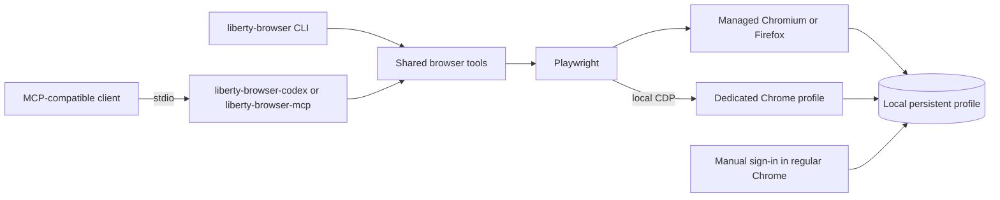

# Architecture

## Runtime modes

- **Generic MCP:** `liberty-browser-mcp` exposes the shared tools over stdio and launches a Playwright-managed browser on demand.
- **Codex with Chrome:** `liberty-browser-codex` exposes the same tools. On the first browser action it starts the dedicated Chrome profile if necessary, waits for the loopback CDP endpoint, verifies the Chrome process and profile, then attaches through Playwright. This launcher currently supports Windows.
- **CLI:** `liberty-browser` runs one-shot actions or keeps an interactive shell open. The `login` command opens ordinary Chrome without debugging flags; `attach` starts that same dedicated profile with local CDP enabled.

## Privacy and security boundary

- Browser profiles live outside the repository in the user's local application data directory.
- Source distributions, wheels, and GitHub commits contain no browser profile, cookies, or account credentials.
- CDP is bound to loopback and the Codex launcher checks that the endpoint belongs to the expected Chrome profile.
- The MCP can act with the permissions of its connected signed-in browser session. Site-specific access controls, CAPTCHA, and account verification remain under the site's control.

## Validation

The automated suite covers MCP stdio initialization and browser actions, CLI navigation and form actions, session persistence in a temporary profile, and Chrome login/attach launch arguments. CI is configured for Windows, Linux, and macOS with Python 3.10 and 3.12. The Windows CDP cold-start path is also exercised with a temporary profile before release.
